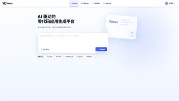
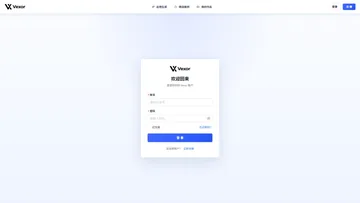
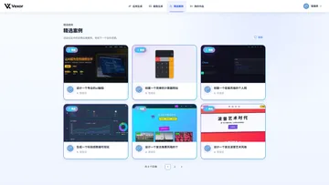
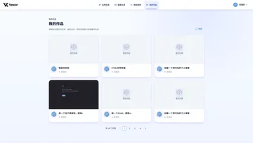
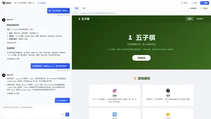
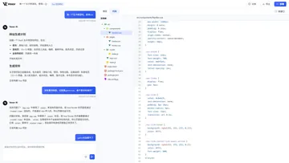
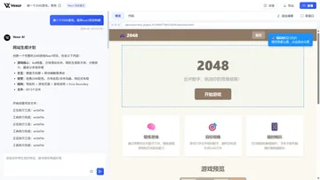
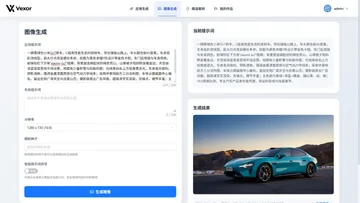
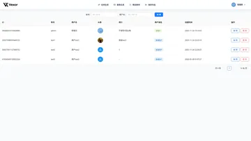
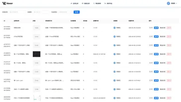

# Vexor Frontend

**Vexor 零代码应用生成平台的前端：对话式生成、实时预览、源码查看与可视化管理。**

[](https://vuejs.org)
[](https://www.typescriptlang.org)
[](https://vite.dev)
[](https://antdv.com)

> [后端仓库](https://github.com/X1aoM1ngTX/zerocode-backend)


## 目录

- [项目简介](#项目简介)
- [界面预览](#界面预览)
- [技术栈](#技术栈)
- [项目结构](#项目结构)
- [快速开始](#快速开始)
- [可用脚本](#可用脚本)
- [核心功能](#核心功能)
- [环境变量](#环境变量)
- [开发指南](#开发指南)
- [部署](#部署)
- [常见问题](#常见问题)
- [贡献指南](#贡献指南)
- [许可证](#许可证)

## 项目简介

Vexor Frontend 是 Vexor 零代码平台的前端应用，使用 Vue 3 + TypeScript + Vite 构建，负责把 AI 代码生成能力包装成完整的创作工作台：

- 在首页用自然语言创建应用，或从模板快速开始
- 在对话工作台中通过 SSE 观看 AI 实时生成，并在右侧 iframe 预览结果
- 在预览区开启可视化编辑，点选页面元素后直接描述修改
- 在源码工作区浏览生成项目的文件树与代码
- 管理自己的作品、浏览精选案例、生成 AI 图像
- 管理员可以在后台管理用户、应用和对话

## 界面预览

| 首页 · 一句话开始创建 | 登录 · 会话式认证 |
| :---: | :---: |
| [](docs/images/screenshots/home.webp) | [](docs/images/screenshots/login.webp) |
| 输入需求或选择模板，一键创建应用 | 登录后由后端 Spring Session 维持会话 |
| **精选案例 · 社区作品** | **我的作品 · 应用管理** |
| [](docs/images/screenshots/featured.webp) | [](docs/images/screenshots/works.webp) |
| 浏览精选应用，复制灵感 | 分页查看、继续对话或打开已部署作品 |
| **对话生成 · SSE + 实时预览** | **源码工作区 · 文件树 + 高亮** |
| [](docs/images/screenshots/chat-preview.webp) | [](docs/images/screenshots/chat-code.webp) |
| 左侧对话，右侧实时预览与部署入口 | 查看生成项目的完整目录结构与源码 |
| **可视化编辑 · 点选元素** | **AI 文生图 · 提示词与参数** |
| [](docs/images/screenshots/visual-edit.webp) | [](docs/images/screenshots/image-gen.webp) |
| 在预览中选中元素，让 AI 精准修改 | 正负提示词、分辨率、随机种子与智能改写 |

## 技术栈

| 分类 | 技术 |
| --- | --- |
| 框架 | Vue 3.5（Composition API + `<script setup>`） |
| 语言 | TypeScript ~5.8 |
| 构建 | Vite 7 |
| UI | Ant Design Vue 4.2.6 |
| 状态 | Pinia 3.0.3 |
| 路由 | Vue Router 4.5.1（history 模式） |
| HTTP | Axios 1.13.2 |
| Markdown / 高亮 | markdown-it 14 · highlight.js 11.11 |
| 其他 | dayjs · nprogress · material-icon-theme |
| 规范 | ESLint 9 · Prettier 3.5 |
| 类型生成 | @umijs/openapi（`npm run generate-api`） |

## 项目结构

```text
src/
├── access/                  # 权限枚举、checkAccess 与全局访问守卫
├── api/                     # 接口封装（app / user / chatHistory / image / static / health）
│   ├── typings.d.ts         # 由 OpenAPI 规范生成的类型
│   └── index.ts
├── assets/                  # Logo 与静态图片
├── components/              # 通用组件
│   ├── auth/                #   AuthCard 登录/注册卡片
│   ├── common/              #   EmptyState / PageLoader / ParticleSystem / SkeletonLoader
│   ├── gallery/             #   AppGallery 应用画廊
│   ├── AppCard.vue          #   应用卡片
│   ├── AppDetailModal.vue   #   应用详情弹窗
│   ├── AppFileTreeNode.vue  #   源码工作区文件树
│   ├── DeploySuccessModal.vue
│   ├── MarkdownRenderer.vue #   AI 流式 Markdown 渲染
│   └── UserInfo.vue
├── composables/             # useCopy / useDebounce / useErrorHandler / useLoading / usePermission
├── config/                  # 环境变量读取（env.ts / env.example.ts）
├── layouts/                 # BasicLayout / GlobalHeader / GlobalFooter
├── pages/
│   ├── admin/               # 用户 / 应用 / 对话管理
│   ├── app/                 # AppChatPage 工作台 · AppEditPage 应用信息
│   ├── error/               # 404
│   ├── user/                # 登录 / 注册 / 重置密码 / 个人中心
│   ├── FeaturedPage.vue
│   ├── HomePage.vue
│   ├── ImageGenPage.vue
│   └── WorksPage.vue
├── request/                 # Axios 实例、拦截器与请求方法
├── router/
│   ├── index.ts             # 路由表（懒加载 + meta）
│   └── guards.ts            # 页面标题与 NProgress
├── stores/                  # Pinia：loginUser
├── styles/                  # 全局样式与 CSS 变量
├── types/                   # 类型声明
├── utils/                   # codeGenTypes / visualEditor / logger / time
├── App.vue
└── main.ts
```

> 访问权限由 `src/access/index.ts` 中的全局 `beforeEach` 统一处理，`src/router/guards.ts` 只负责页面标题与顶部加载条。

## 快速开始

### 环境要求

- Node.js 22+
- npm（或 pnpm / yarn）
- 已启动的 Vexor 后端（默认 `http://localhost:8123`）

### 安装与启动

```bash
npm install
npm run dev
```

访问 <http://localhost:5173>。Vite 开发服务器已将 `/api` 代理到 `http://localhost:8123`，无需额外配置跨域。

后端启动与配置见 [后端 README](https://github.com/X1aoM1ngTX/zerocode-backend#快速开始)。

## 可用脚本

| 命令 | 说明 |
| --- | --- |
| `npm run dev` | 启动 Vite 开发服务器 |
| `npm run build` | 类型检查 + 生产构建 |
| `npm run build-only` | 仅生产构建（跳过类型检查） |
| `npm run preview` | 本地预览生产构建产物 |
| `npm run type-check` | `vue-tsc` 类型检查 |
| `npm run lint` | ESLint 检查并自动修复 |
| `npm run format` | Prettier 格式化 `src/` |
| `npm run generate-api` | 从后端 OpenAPI 文档生成 TypeScript 类型 |

## 核心功能

### 1. 对话式 AI 生成

`AppChatPage` 通过 `EventSource` 连接后端 `/api/app/chat/gen/code/v2`，实时处理以下事件：

- AI 文本增量：交给 `MarkdownRenderer` 做流式 Markdown 渲染与代码高亮
- 工具调用：展示 `writeFile`、`modifyFile` 等工具的请求与执行结果
- 预览就绪：生成完成后自动刷新 iframe，展示最新页面
- 生成结束：恢复输入框，刷新文件树与历史消息

页面同时维护聊天历史分页加载、生成状态与部署入口。

### 2. 实时预览与可视化编辑

- 预览地址由 `getStaticPreviewUrl(codeGenType, appId)` 生成，Vue / React 工程会指向 `dist/index.html`
- 点击「编辑模式」后，`src/utils/visualEditor.ts` 会向 iframe 注入悬浮与选中逻辑
- 选中元素后，页面把标签、选择器、文本内容、页面路径等上下文附加到下一条用户消息，AI 可以更精准地修改对应区域
- 修改完成后，预览 iframe 自动刷新

### 3. 源码工作区

对话页的「代码」标签页由 `AppFileTreeNode` 渲染生成项目的文件树，右侧使用 highlight.js 展示带行号的源码。工作区用于**查看**生成结果；代码修改通过对话完成，应用信息编辑页则用于维护名称、封面、优先级等元数据。

### 4. 应用与后台管理

- 首页：创建应用、优化提示词、快速模板
- 我的作品：分页查看自己创建的应用，支持继续对话与打开已部署作品
- 精选案例：浏览管理员设置为精选的应用
- 应用详情：查看应用信息、部署状态与访问入口
- 管理后台：用户管理、应用管理、对话管理，支持检索、精选设置与删除

| 用户管理（管理员） | 应用管理（管理员） |
| :---: | :---: |
| [](docs/images/screenshots/admin-users.webp) | [](docs/images/screenshots/admin-apps.webp) |

### 5. AI 图像生成

`ImageGenPage` 提供正向/负向提示词、分辨率、随机种子和智能提示词改写，调用后端 `/api/image/generate`，由 DashScope 文生图模型返回图片。

### 6. 登录、权限与路由

- `src/stores/loginUser.ts` 在应用启动时调用 `/api/user/get/login` 自动恢复登录态
- `src/access/index.ts` 在全局前置守卫中读取 `route.meta.access`：
  - 未登录访问受保护页面 → 跳转登录页并携带 `redirect`
  - 已登录但权限不足 → 路由守卫拦截，不会进入管理页面
- `src/composables/usePermission.ts` 提供组件内的 `isAdmin`、`hasPermission` 等判断
- 顶部导航根据权限过滤菜单项

### 7. API 类型自动生成

后端启动后：

```bash
npm run generate-api
```

配置位于 `openapi2ts.config.ts`，默认读取 `http://localhost:8123/api/v3/api-docs`，输出到 `src/api/typings.d.ts`。新增接口时先重新生成类型，再在 `src/api/` 中封装请求函数。

## 环境变量

参考 `src/config/env.example.ts`，在项目根目录创建 `.env.local`（开发）或 `.env.production`（生产）：

| 变量 | 默认值 | 说明 |
| --- | --- | --- |
| `VITE_API_BASE_URL` | `/api` | API 基础路径；开发环境走 Vite 代理 |
| `VITE_DEPLOY_DOMAIN` | `http://localhost` | 部署应用访问域名，用于拼接部署链接 |

```bash
# .env.local 示例
VITE_DEPLOY_DOMAIN=http://localhost
VITE_API_BASE_URL=/api
```

> Vite 只会注入以 `VITE_` 开头的变量；修改 `.env.*` 后需重启开发服务器。

## 开发指南

### 添加新页面

1. 在 `src/pages/` 下创建 `<script setup lang="ts">` 组件
2. 在 `src/router/index.ts` 中添加懒加载路由与 `meta`
3. 需要登录/管理员权限时设置 `meta.access`，访问守卫会自动拦截
4. 需要隐藏页脚或全屏布局时使用 `meta.hideFooter` / `meta.fullscreen`

### 添加 API 接口

1. 启动后端并运行 `npm run generate-api`
2. 在 `src/api/` 中基于生成的类型封装请求
3. 统一从 `src/request/` 导入 Axios 实例，使用 `useErrorHandler` 处理业务错误提示

### 权限与登录态

```ts
import { usePermission } from '@/composables'

const { isAdmin, hasPermission } = usePermission()
```

路由级权限通过 `meta.access` 声明，不要在页面内重复做跳转判断。

### 代码风格

- 组件与页面文件使用 PascalCase；`composables`、`utils` 使用 camelCase
- 使用 Composition API 与 `<script setup>`
- 提交前运行 `npm run type-check` 与 `npm run lint`
- API 响应类型统一来自 `src/api/typings.d.ts`

## 部署

### 构建

```bash
npm run build
```

产物输出到 `dist/`。构建阶段会执行 `vue-tsc` 类型检查，CI 中也可先单独运行 `npm run type-check`。

### Nginx 配置示例

```nginx
server {
    listen 80;
    server_name your-domain.com;
    root /path/to/dist;
    index index.html;

    location / {
        try_files $uri $uri/ /index.html;
    }

    location /api {
        proxy_pass http://localhost:8123;
        proxy_set_header Host $host;
        proxy_set_header X-Real-IP $remote_addr;
        # SSE 流式生成必须关闭缓冲
        proxy_buffering off;
        proxy_read_timeout 300s;
    }
}
```

> 如果前后端分开部署，请在构建前把 `VITE_API_BASE_URL` 设置为后端可访问的完整地址，并在后端配置好 CORS。

## 常见问题

- **开发服务器启动失败**：确认 Node.js ≥ 22；端口被占用时 Vite 会自动尝试下一个端口，也可以调整 `vite.config.ts` 的 `server.port`。
- **接口 404 / 502**：确认后端已在 `8123` 端口启动；检查 `vite.config.ts` 中的代理目标。
- **登录后仍跳回登录页**：确认浏览器允许 Cookie，且前端与后端通过同一域名/代理访问。
- **AI 生成内容不实时刷新**：反向代理必须关闭 SSE 缓冲（`proxy_buffering off`），并适当增大读取超时。
- **预览区域空白**：确认应用已生成完成、后端静态资源接口可访问；Vue / React 工程还需要 `dist/index.html` 构建产物。
- **类型检查失败**：先运行 `npm run type-check` 定位具体文件，再运行 `npm run lint` 修复规范问题。

## 贡献指南

1. Fork 本仓库
2. 创建特性分支（`git checkout -b feature/AmazingFeature`）
3. 提交更改（`git commit -m 'feat: add some AmazingFeature'`）
4. 推送到分支（`git push origin feature/AmazingFeature`）
5. 开启 Pull Request

## 许可证

本项目采用 MIT 许可证发布。
